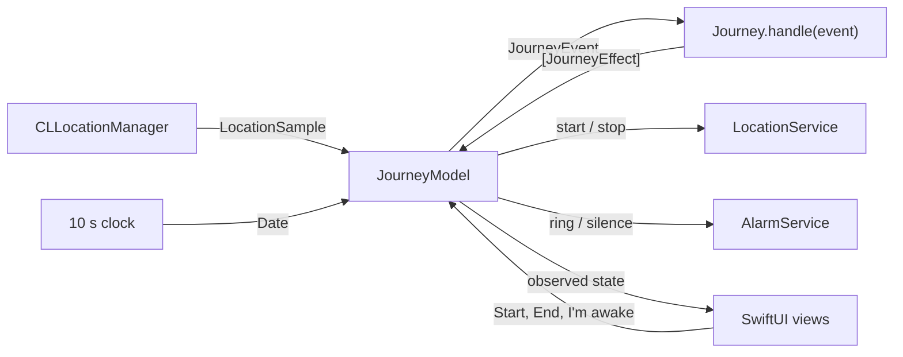

# Destination Arrival

[](https://github.com/ardakaan78715-gif/destination-arrival/actions/workflows/ci.yml)

An iOS alarm that wakes you about two minutes before your stop, even deep in the London Underground.

## Why it exists

You nod off on the train and wake up two stops too late. Map apps will show you where you are, but they will not wake you up. Destination Arrival does one thing: it watches the journey and rings shortly before you arrive.

## What it does

- Opens on a map of London. Search for a station or address, or tap the map to drop a pin. Places outside London are refused for now.
- Lets you choose how early to be woken: 1, 2, 3, 5 or 10 minutes before arrival (2 minutes by default). It also rings once you are within 750 m of the stop, whichever happens first.
- Asks for location and notification permission only when you tap **Start journey**.
- Shows the time to arrival, the distance left, when the alarm will go off and the signal status (Live GPS, Stopped, Waiting to move, or No signal · estimating), updated every second.
- Ignores GPS glitches and platform jitter, and keeps its speed estimate through station stops.
- Keeps counting down when the GPS signal disappears in a tunnel, and rings on that projection instead of waiting for a fix that may never come.
- Rings with a full-screen alert and a notification, then stops with one large **I'm awake** button.

Tracking currently runs while the app is open. Background tracking with a locked phone is next on the [roadmap](#roadmap).

## How it decides when to wake you

Every rule below lives in the ArrivalKit package, behind `Journey.handle(_:)`, and is covered by unit tests.

1. **Filter the fixes.** A location fix is dropped if its accuracy is negative or worse than 200 m, if it was cached more than 60 seconds before the journey started, if it is not newer than the last accepted fix, or if getting there from the last accepted fix implies a speed above 90 m/s. The jump check divides by the time since that fix, so the first fix after a four-minute tunnel is accepted even though it is kilometres from the last one.
2. **Measure the cruise speed.** Fixes accurate to 100 m or better become speed points at least 10 seconds apart. A step between two points counts as moving only when it covers more ground than the fixes' accuracy and averages at least 2.5 m/s. The cruise speed is the moving distance divided by the moving time over the last 3 minutes, once at least 30 seconds of movement has been seen. It is worked out again only when a new moving step arrives, so station dwells and platform jitter never drag it towards zero, and braking into a station cannot pull it down while the train waits. The last measured speed is kept through stops.
3. **Take the pessimistic distance.** The straight-line distance to the stop is reduced by the fix's accuracy, giving the closest the phone could be. A coarse 150 m station Wi-Fi fix still counts, but it can only bring the alarm forward.
4. **Estimate the time to arrival** as that distance divided by the cruise speed. Until a speed has been measured, it assumes 15 m/s, which is faster than any London Underground line's average.
5. **Work out one alarm time.** The alarm distance is `max(cruise speed × lead time, radius)`. The alarm time is the moment the train, projected forward from the last fix, reaches that distance. Everything that rings uses this one date.
6. **Check on every fix and every 10 seconds.** The alarm rings when you are inside the radius, or once the alarm time has come. At the moment of a fix this is exactly "time to arrival at most the lead time, or inside the radius". An assumed speed only counts once the signal has been lost, so jitter while standing on a platform is never mistaken for a train about to arrive.
7. **Ring exactly once.** Late fixes and clock ticks after the alarm are ignored.

### Why it errs early

- A straight line is never longer than the track, so the distance left is never overestimated.
- The cruise speed leaves out the station dwells still to come, which shortens the estimated time left rather than stretching it.
- Every distance is reduced by the fix's accuracy.
- Between fixes, the projection runs at 1.1 times the cruise speed and never below 15 m/s.

Each of these can only move the alarm earlier. Waking a minute early is a small cost; missing the stop is the failure the app exists to prevent.

### Tuning

The constants live in `ArrivalTuning.standard`, which is passed into `Journey` so tests can vary it.

| Constant | Value | Reason |
|---|---|---|
| `maximumAccuracy` | 200 m | Station Wi-Fi fixes (30-150 m) count for distance; cell-tower fixes (kilometres) do not |
| `maximumSpeedAccuracy` | 100 m | Speed needs fixes sharp enough to measure 10 s of travel |
| `maximumPlausibleSpeed` | 90 m/s | Faster implied jumps are glitches. It uses the elapsed time, so a long tunnel gap still passes |
| `staleFixAllowance` | 60 s | Cached fixes from before the journey started are ignored |
| `speedStep` | 10 s | Minimum spacing between speed points |
| `maximumSpeedStep` | 30 s | A longer gap may hide a stop, so it never counts towards speed |
| `movingSpeed` | 2.5 m/s | Slower steps are a dwell or jitter |
| `speedWindow` | 180 s | Long enough to span a station dwell |
| `minimumMovingTime` | 30 s | Moving time needed before a speed counts as measured |
| `signalLossAfter` | 45 s | Longer than any normal gap between fixes while standing at a platform |
| `cautionFactor` | 1.1 | Between fixes, assume the train is 10% faster than measured |
| `fastTrainSpeed` | 15 m/s | Speed used when none has been measured, and the floor for projections. Faster than any London Underground average, Elizabeth line included |

## Designed for the Underground

Deep tunnels give no GPS for minutes at a time. Some stations give a coarse Wi-Fi fix, and a phone's instantaneous speed reads zero at every platform. When the app is unsure, every rule below moves the alarm earlier, never later.

- **Cruise speed, not instantaneous speed.** Only moving steps of 10 to 30 seconds count, so a 40-90 second dwell inside the 3-minute window leaves the speed intact. `CLLocation.speed` is never used.
- **Pessimistic distance.** Every distance is reduced by the fix's accuracy, so a 150 m station Wi-Fi fix can only make the alarm earlier.
- **Signal loss is explicit.** After 45 seconds without an accepted fix, the status changes to "No signal for 3 min · estimating". The location manager's distance filter is off, so silence really means no fix.
- **Dead reckoning.** A clock tick every 10 seconds checks the alarm again, with the journey projected forward from the last fix at a cautious speed:

  ```
  projection speed   vp = max(1.1 × v, 15 m/s)
  distance left(t)      = max(0, D − vp × (t − t0))
  time left(t)          = distance left(t) ÷ v
  alarm time            = t0 + max(0, (D − max(v × lead time, radius)) ÷ vp)
  ```

  Here `t0` is the time of the last accepted fix, `D` is the pessimistic distance at that fix and `v` is the cruise speed, or 15 m/s until one has been measured.
- **Re-anchoring.** Any later fix, from station Wi-Fi or on reaching the surface, becomes the new starting point at once. A held train pushes the alarm back; a faster one brings it forward. In the Elizabeth line scenario below, a single fix while boarding at Paddington would ring 415 s early; the Wi-Fi fix at Farringdon re-anchors the projection and brings that down to 205 s.
- **Boarding underground.** With no measured speed, the projection assumes 15 m/s, so on most lines the alarm comes early. While the GPS is live, an assumed speed never rings: standing on a platform 1.5 km from home is not "two minutes away".

### Scenarios

Each row is a replay in `RouteJourneyTests`. On the surface the replay sends a fix every second with 10 m accuracy and up to 8 m of seeded jitter; underground it sends none. A clock tick arrives every 10 seconds, the lead time is 2 minutes and the radius is 750 m.

| Scenario | Rings before arrival | The test asserts |
|---|---|---|
| Stopping service: 8 stations 1.2 km apart, 86 s runs, 40 s dwells, live GPS | 156 s | 115-200 s |
| Elizabeth line, Paddington to Canary Wharf underground, one 65 m Wi-Fi fix 10 s into the Farringdon dwell | 205 s | 110-330 s |
| Victoria line, Brixton to Oxford Circus underground, one 65 m Wi-Fi fix at Brixton | 570 s, on the projection | at least 110 s, on the projection |
| Train held for 3 minutes in a tunnel with no fixes | 310 s | at least 110 s |
| Standing still for 30 minutes with live GPS, 5 km away | never | never rings |

The routes are synthetic: straight lines between public station locations with invented timings, not TfL data.

## Architecture



| Folder | Role |
|---|---|
| `Packages/ArrivalKit` | Pure Swift package with every decision: models, fix filtering, cruise speed, the arrival estimate and the `Journey` state machine. It uses only Foundation and CoreLocation types and is fully unit-tested. |
| `App/Services` | Protocols for location, alarms and place search, plus implementations on UserNotifications and MapKit. |
| `App/Platform` | The only folder that touches iOS-only APIs: the `CLLocationManager` wrapper and the live composition of services. |
| `App/Planning`, `App/Journey` | `@Observable` models and SwiftUI screens for choosing a destination, tracking the journey and ringing. |

**Why a reducer.** `Journey` is a value type that turns each event (journey started, location received, clock ticked, alarm stopped, cancelled) into a list of effects (start or stop location updates, ring, silence). It has no clocks, timers or I/O, and time arrives inside the events. That makes it deterministic: every scenario is just a list of fixes and ticks, and the tests replay them on macOS. The app performs the effects through injected services and contains no arrival logic of its own.

## Run it

Requirements: Xcode 16 or later and iOS 17 or later. No developer account is needed to run it in the Simulator.

1. Open `DestinationArrival.xcodeproj` and run the **DestinationArrival** scheme on an iPhone simulator.
2. The scheme simulates a location in central London. To see the alarm, pick a destination within 750 m of it, or move the simulated location with **Features > Location > Custom Location**.

The Xcode project is generated by XcodeGen from `project.yml`. After changing `project.yml`, run `xcodegen generate` and commit both.

## Tests

```sh
swift test --package-path Packages/ArrivalKit
```

The tests use Swift Testing. ArrivalKit imports only Foundation and CoreLocation, so the whole suite runs on macOS with just the Swift toolchain: no Xcode, no simulator and no device. They cover the destination and settings models, the London service area and distance measurement; the fix filter's rules and their order; the cruise speed through steady runs, station dwells, platform jitter, coarse fixes and long gaps; the arrival estimate, its projection between fixes, its alarm time and its signal status; the journey state machine: starting, ignoring rejected fixes, ringing inside the radius, ringing within the lead time, ringing on the projection after signal loss, re-anchoring on a fresh fix, never ringing on jitter, ringing exactly once, stopping, cancelling and ignoring events before the start; and whole journeys replayed fix by fix and tick by tick, from the scenario table above. Jittered fixes come from a seeded generator, so every run is identical.

### Continuous integration

Every push to `main` and every pull request runs two jobs on GitHub's macOS 15 runners:

| Job | What it does |
|---|---|
| **ArrivalKit tests** | Runs `swift test --package-path Packages/ArrivalKit`, so every arrival rule is checked on each change. |
| **iOS Simulator build** | Builds the app for the generic iOS Simulator with `xcodebuild` and `CODE_SIGNING_ALLOWED=NO`, so no certificate or developer account is involved. It uses the committed Xcode project, so CI does not need XcodeGen. |

## Privacy

Everything stays on the device. There are no accounts, analytics or third-party SDKs. Location is used only during a journey, with When In Use permission. MapKit search is the only network use.

## Known limitations

- **An express tunnel can ring late.** If a train runs slowly on the surface (about 12 m/s) and then fast through a long express tunnel (about 22 m/s), the projection falls behind and the alarm can be up to about a minute late. The 15 m/s projection floor limits the damage.
- **Boarding with no signal rings early.** Without a measured speed the app assumes a fast train, so on slower lines it can ring several minutes early, as in the Victoria line scenario. Any station fix on the way corrects the estimate.
- **Looping routes ring early.** The estimate uses straight-line distance, so a line that swings away from the destination and back again rings sooner than it needs to.
- **Search needs a signal.** Choose the destination before going underground. Dropping a pin on the map works without one.

## Roadmap

- Background tracking with the phone locked, with battery-aware accuracy
- A loud alarm through the silent switch, a lock-screen Stop button and a backup alarm held by iOS
- A timed Simulator demo route along the Metropolitan line
- Settings for the wake radius and distance units, and a way to test the alarm
- Recent and favourite destinations
- Readiness checks before a journey, and accessibility across every screen
- Siri and Shortcuts, AlarmKit on iOS 26, and a Live Activity
- More cities beyond London

## Licence

MIT. Copyright (c) 2026 ardakaan78715-gif. See [LICENSE](LICENSE).
