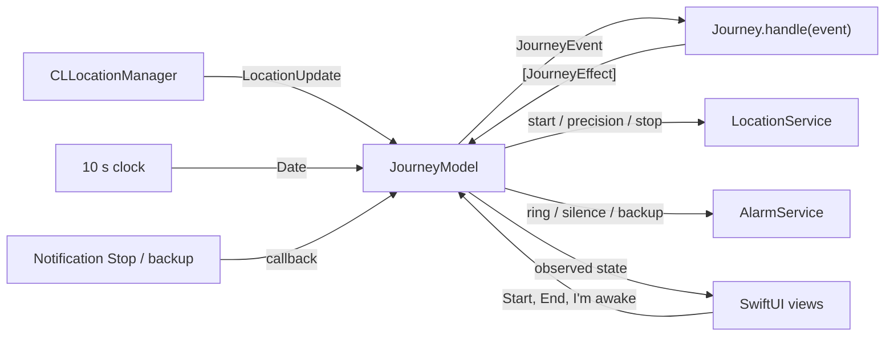

# Destination Arrival

[](https://github.com/ardakaan78715-gif/destination-arrival/actions/workflows/ci.yml)

An iOS alarm that wakes you about two minutes before your stop, even deep in the London Underground.

## Why it exists

You nod off on the train and wake up two stops too late. Map apps will show you where you are, but they will not wake you up. Destination Arrival does one thing: it watches the journey and rings shortly before you arrive.

## What it does

- Opens on a map of London. Search for a station or address, or tap the map to drop a pin. Places outside London are refused for now.
- Lets you choose how early to be woken: 1, 2, 3, 5 or 10 minutes before arrival (2 minutes by default). It also rings once you are inside a wake radius around the stop, whichever happens first. A slider sets the radius from 200 m to 3 km (750 m by default), and the circle on the map follows it as you drag.
- Remembers the last eight places you travelled to, and any you star as favourites. Until you choose a place they sit in the panel under the map as one-tap buttons, and they appear in search before you type, so a regular journey is one tap away, even with no signal to search. Places within 50 m of each other count as one, and a long press removes a place.
- Remembers the lead time and radius you last used, so the next journey starts with them. Settings, behind the gear button, show distances in kilometres or miles (or follow the device), play a short **Test the alarm** tone at the current media volume, and list tips for making sure you hear it.
- Asks for location and notification permission only when you tap **Start journey**, then checks that the phone is ready. A journey that cannot work does not start, and settings that make the alarm easier to miss are listed with a way to fix them and a **Start anyway** button.
- Shows the time to arrival, the distance left, when the alarm will go off and the signal status (Live GPS, Stopped, Waiting to move, or No signal · estimating), updated every second.
- Ignores GPS glitches and platform jitter, and keeps its speed estimate through station stops.
- Keeps counting down when the GPS signal disappears in a tunnel, and rings on that projection instead of waiting for a fix that may never come.
- Keeps tracking with the phone locked or another app in front, under When In Use permission, starting at a battery-saving accuracy and sharpening it as you near the stop.
- Rings with a looping tone that plays even with the silent switch on, a full-screen alert and a lock-screen notification. One large **I'm awake** button, or **Stop** on the notification without unlocking, ends it.
- Keeps a backup alarm with iOS at the projected alarm time, so the phone still alerts you if iOS stops the app on the way.
- Says so straight away if location access is turned off during a journey, with the time of the backup alarm that is still set, instead of quietly tracking nothing.
- Comes with a timed Metropolitan line journey for the Simulator, and a debug switch that cuts location fixes to show the tunnel estimate live.
- Works with VoiceOver, large text and Reduce Motion on every screen, and announces when the signal drops, when it returns and when the alarm rings.

## How it decides when to wake you

Every rule below lives in the ArrivalKit package, behind `Journey.handle(_:)`, and is covered by unit tests.

1. **Filter the fixes.** A location fix is dropped if its accuracy is negative or worse than 200 m, if it was cached more than 60 seconds before the journey started, if it is not newer than the last accepted fix, or if getting there from the last accepted fix implies a speed above 90 m/s. The jump check divides by the time since that fix, so the first fix after a four-minute tunnel is accepted even though it is kilometres from the last one.
2. **Measure the cruise speed.** Fixes accurate to 100 m or better become speed points at least 10 seconds apart. A step between two points counts as moving only when it covers more ground than the fixes' accuracy and averages at least 2.5 m/s. The cruise speed is the moving distance divided by the moving time over the last 3 minutes, once at least 30 seconds of movement has been seen. It is worked out again only when a new moving step arrives, so station dwells and platform jitter never drag it towards zero, and braking into a station cannot pull it down while the train waits. The last measured speed is kept through stops.
3. **Take the pessimistic distance.** The straight-line distance to the stop is reduced by the fix's accuracy, giving the closest the phone could be. A coarse 150 m station Wi-Fi fix still counts, but it can only bring the alarm forward.
4. **Estimate the time to arrival** as that distance divided by the cruise speed. Until a speed has been measured, it assumes 15 m/s, which is faster than any London Underground line's average.
5. **Work out one alarm time.** The alarm distance is `max(cruise speed × lead time, radius)`. The alarm time is the moment the train, projected forward from the last fix, reaches that distance. Everything that rings uses this one date: the in-app alarm and the backup held by iOS.
6. **Check on every fix and every 10 seconds.** The alarm rings when you are inside the radius, or once the alarm time has come. At the moment of a fix this is exactly "time to arrival at most the lead time, or inside the radius". An assumed speed only counts once the signal has been lost, so jitter while standing on a platform is never mistaken for a train about to arrive.
7. **Ring exactly once.** Late fixes and clock ticks after the alarm are ignored.

### Why it errs early

- A straight line is never longer than the track, so the distance left is never overestimated.
- The cruise speed leaves out the station dwells still to come, which shortens the estimated time left rather than stretching it.
- Every distance is reduced by the fix's accuracy.
- Between fixes, the projection runs at 1.1 times the cruise speed and never below 15 m/s.

Each of these can only move the alarm earlier. Waking a minute early is a small cost; missing the stop is the failure the app exists to prevent.

### Tuning

The constants live in `ArrivalTuning.standard`, which is passed into `Journey` so tests can vary it.

| Constant | Value | Reason |
|---|---|---|
| `maximumAccuracy` | 200 m | Station Wi-Fi fixes (30-150 m) count for distance; cell-tower fixes (kilometres) do not |
| `maximumSpeedAccuracy` | 100 m | Speed needs fixes sharp enough to measure 10 s of travel |
| `maximumPlausibleSpeed` | 90 m/s | Faster implied jumps are glitches. It uses the elapsed time, so a long tunnel gap still passes |
| `staleFixAllowance` | 60 s | Cached fixes from before the journey started are ignored |
| `speedStep` | 10 s | Minimum spacing between speed points |
| `maximumSpeedStep` | 30 s | A longer gap may hide a stop, so it never counts towards speed |
| `movingSpeed` | 2.5 m/s | Slower steps are a dwell or jitter |
| `speedWindow` | 180 s | Long enough to span a station dwell |
| `minimumMovingTime` | 30 s | Moving time needed before a speed counts as measured |
| `signalLossAfter` | 45 s | Longer than any normal gap between fixes while standing at a platform |
| `cautionFactor` | 1.1 | Between fixes, assume the train is 10% faster than measured |
| `fastTrainSpeed` | 15 m/s | Speed used when none has been measured, and the floor for projections. Faster than any London Underground average, Elizabeth line included |
| `precisionDistance` / `precisionTime` | 5 km / 600 s | Switch to precise tracking inside either |
| `backupRescheduleThreshold` | 20 s | Move the backup alarm held by iOS only when the alarm time shifts by more than this |

## Designed for the Underground

Deep tunnels give no GPS for minutes at a time. Some stations give a coarse Wi-Fi fix, and a phone's instantaneous speed reads zero at every platform. When the app is unsure, every rule below moves the alarm earlier, never later.

- **Cruise speed, not instantaneous speed.** Only moving steps of 10 to 30 seconds count, so a 40-90 second dwell inside the 3-minute window leaves the speed intact. `CLLocation.speed` is never used.
- **Pessimistic distance.** Every distance is reduced by the fix's accuracy, so a 150 m station Wi-Fi fix can only make the alarm earlier.
- **Signal loss is explicit.** After 45 seconds without an accepted fix, the status changes to "No signal for 3 min · estimating". The location manager's distance filter is off, so silence really means no fix.
- **Dead reckoning.** A clock tick every 10 seconds checks the alarm again, with the journey projected forward from the last fix at a cautious speed:

  ```
  projection speed   vp = max(1.1 × v, 15 m/s)
  distance left(t)      = max(0, D − vp × (t − t0))
  time left(t)          = distance left(t) ÷ v
  alarm time            = t0 + max(0, (D − max(v × lead time, radius)) ÷ vp)
  ```

  Here `t0` is the time of the last accepted fix, `D` is the pessimistic distance at that fix and `v` is the cruise speed, or 15 m/s until one has been measured.
- **Re-anchoring.** Any later fix, from station Wi-Fi or on reaching the surface, becomes the new starting point at once. A held train pushes the alarm back; a faster one brings it forward. In the Elizabeth line scenario below, a single fix while boarding at Paddington would ring 415 s early; the Wi-Fi fix at Farringdon re-anchors the projection and brings that down to 205 s.
- **Boarding underground.** With no measured speed, the projection assumes 15 m/s, so on most lines the alarm comes early. While the GPS is live, an assumed speed never rings: standing on a platform 1.5 km from home is not "two minutes away".

### Scenarios

Each row is a replay in `RouteJourneyTests` or `MetropolitanLineReplayTests`. On the surface the replay sends a fix every second with 10 m accuracy and up to 8 m of seeded jitter; underground it sends none. A clock tick arrives every 10 seconds, the lead time is 2 minutes and the radius is 750 m.

| Scenario | Rings before arrival | The test asserts |
|---|---|---|
| Stopping service: 8 stations 1.2 km apart, 86 s runs, 40 s dwells, live GPS | 156 s | 115-200 s |
| Metropolitan line, Harrow-on-the-Hill to Baker Street, in a tunnel from Finchley Road | 186 s, on the projection | 110-300 s, on the projection |
| The same route to Finchley Road, live GPS all the way | 133 s | 110-200 s |
| Elizabeth line, Paddington to Canary Wharf underground, one 65 m Wi-Fi fix 10 s into the Farringdon dwell | 205 s | 110-330 s |
| Victoria line, Brixton to Oxford Circus underground, one 65 m Wi-Fi fix at Brixton | 570 s, on the projection | at least 110 s, on the projection |
| Train held for 3 minutes in a tunnel with no fixes | 310 s | at least 110 s |
| Standing still for 30 minutes with live GPS, 5 km away | never | never rings |

The routes are synthetic: straight lines between public station locations with invented timings, not TfL data. The Metropolitan line rows replay `Simulation/MetropolitanLine.gpx`, the same file the Simulator plays, and give the same result for every jitter seed to within 5 seconds.

## Making sure you hear it

An alarm that does not wake you is worse than none, so the app rings in layers. Every layer uses the same alarm time.

1. **A loud tone while the app runs.** This is the normal case: background location keeps the app running for the whole journey. When the alarm is due, the app loops a 25-second tone on a `.playback` audio session, which plays even with the silent switch on. The session ducks other audio, so a podcast gets quieter instead of stopping, and that also lets the tone start while the app is in the background. The `audio` background mode keeps the tone playing after location updates stop. The full-screen alert has one large **I'm awake** button.
2. **A notification on the lock screen.** At the same moment the app posts "Nearly at Baker Street" with a **Stop** button. Stop works from the lock screen without unlocking or opening the app; it silences the tone and ends the journey. With the app open, the notification appears as a banner without a second sound, because the tone is already playing.
3. **A backup held by iOS.** In case iOS stops the app on the way, after a crash, under memory pressure or because it was swiped away, the journey keeps two notifications scheduled with iOS: one at the projected alarm time and a follow-up a minute later, each with the 25-second tone. They are moved only when the alarm time shifts by more than 20 seconds, so a steady journey does not keep rescheduling them, and they are cancelled as soon as the in-app alarm rings or the journey ends. If one arrives while the app is open, the loud alarm takes over. If the app had been closed, tapping **Stop** removes the follow-up.

### Silent switch and Focus

| Situation | Silent switch on | Focus on |
|---|---|---|
| App running in the background (normal while tracking) | The tone rings; the notification lights the screen and vibrates | The tone rings; the notification is held unless the app is allowed in that Focus |
| App closed or stopped by iOS | The backup notifications light the screen and vibrate, with no sound | Held unless the app is allowed in that Focus |

Critical alerts and time-sensitive notifications could break through more of these cases, but critical alerts need an entitlement that Apple grants on request, and time-sensitive notifications need a capability that a free developer account may not offer. The app uses neither and needs no entitlements at all.

### Tips

- **Turn the volume up.** The tone follows the media volume, not the ringer, so the app warns you at the start of a journey if the volume is low.
- **Allow the app in your Focus modes.** Add Destination Arrival to the allowed apps of any Focus you use while travelling, such as Sleep, so its notifications come through.
- **Leave it running.** Keep the app open in the background rather than swiping it away. The backup still fires if you do, but only as notifications, which follow the silent switch.
- **Test it before you set off.** **Test the alarm** in Settings plays three seconds of the tone at the current media volume, so you know it is loud enough.

### Checks before the journey

When you tap **Start journey**, the app asks for location permission and, once that is granted, notification permission. It then takes a snapshot of the phone and turns it into a list of issues with `Readiness.issues(for:)`, a pure function in ArrivalKit. Blockers come first and stop the journey from starting; warnings can be accepted with **Start anyway**.

| Issue | Kind | What the app says |
|---|---|---|
| Location denied | Blocker | Location is off for Destination Arrival. Turn it on in Settings so the alarm knows where you are. |
| Location restricted | Blocker | Location is restricted on this iPhone, for example by Screen Time or device management, so the alarm cannot follow your journey. |
| Already there | Blocker | You're already within the alarm radius of this place. |
| Approximate location | Warning | Precise Location is off. The radius alarm may ring late. |
| Notifications denied | Warning | Notifications are off. The alarm can only sound while the app is running. |
| Low Power Mode | Warning | Low Power Mode is on. iOS may slow down location updates. |
| Low volume | Warning | Turn your volume up. The alarm uses media volume. |

- A permission that has not been asked for yet is never an issue, because the app asks for it at that moment.
- Location and notification issues come with an **Open Settings** button. When you come back to the app, the check runs again, and the journey starts as soon as nothing is in the way.
- "Already there" uses the same rules as the journey itself: the phone's last fix only counts if the journey would accept it (accurate to 200 m and no more than a minute old), and its distance is reduced by its accuracy. So the check refuses exactly the journeys that would ring the moment they started.
- If location access is turned off during a journey, the tracking screen shows a banner with the time of the backup alarm that is still set, and an **Open Settings** button. The countdown carries on as an estimate from the last fix, and the banner goes away if fixes start arriving again. The "no fix right now" error that iOS reports in tunnels is expected and ignored.

The alarm sound, `App/Resources/Alarm.caf`, is a synthesised two-tone beep at 880 Hz and 1320 Hz, generated in code rather than recorded or licensed. It lasts 25 seconds, inside the 30-second limit iOS sets for notification sounds.

## Battery

A journey can last an hour or more, so the app spends as little power on location as it can while still waking you in time.

- **Economy while far away.** Every journey starts at hundred-metre accuracy, which lets iOS save power by relying less on the GPS. That is plenty while the stop is a long way off.
- **Precise when it matters.** As soon as the stop is within 5 km, or the estimate says 10 minutes or less, the journey switches to the best accuracy. It switches once and never back, so it cannot flap between the two. The check runs on every fix and every 10-second tick, so a projection through a tunnel can make the switch too, ready for the first fix after it.
- **Sparse fixes are harmless far away.** Fixes can arrive less often at hundred-metre accuracy, and a long gap reads as signal loss. Economy only applies while the stop is more than 5 km and 10 minutes away, so a projection from such a gap is still minutes from ringing, and the next fix re-anchors it.
- **Nothing runs after the alarm.** Location updates and the 10-second clock stop the moment the alarm rings or the journey ends.

### Tracking in the background

- **Background location.** The app declares the `location` background mode. When you tap **Start journey**, it turns on `allowsBackgroundLocationUpdates`, switches off automatic pausing, which would otherwise stop updates while a train waits at a platform, and holds a `CLBackgroundActivitySession` until the journey ends. Fixes keep arriving with the phone locked or another app in front.
- **When In Use is enough.** The app only ever asks for When In Use permission, never Always. iOS lets an app keep receiving location in the background when it started the updates while you were using it.
- **The blue indicator.** While a journey runs, iOS shows a blue location indicator in the status bar, so it is always clear that the app is following you. Tapping it opens the app. It goes away when the alarm rings or the journey ends.
- **Leave it running.** Closing the app from the app switcher ends tracking, and the app does not yet pick a journey back up after a relaunch. The backup alarm held by iOS still fires at the last projected time. The tracking screen says to keep the app open in the background.

## Architecture



| Folder | Role |
|---|---|
| `Packages/ArrivalKit` | Pure Swift package with every decision: models, fix filtering, cruise speed, the arrival estimate, the `Journey` state machine, the rules for recent and favourite places and the readiness checks. It uses only Foundation and CoreLocation types and is fully unit-tested. |
| `App/Services` | Protocols for location, alarms, the alarm sound, place search and the readiness snapshot, plus implementations on UserNotifications and MapKit. |
| `App/Platform` | The only folder that touches iOS-only APIs: the `CLLocationManager` wrapper with its background session, the `AVAudioSession` tone player, the readiness probe that reads permissions, Low Power Mode and the volume, and the live composition of services, including the link to the app's page in Settings. |
| `App/Planning`, `App/Journey`, `App/Settings` | `@Observable` models and SwiftUI screens for choosing a destination, tracking the journey and ringing, plus the settings screen and the store that keeps the alarm defaults and distance units in `UserDefaults`. |
| `App/Places` | The store that keeps recent and favourite places in a JSON file in the app's Application Support folder, written atomically. |

**Why a reducer.** `Journey` is a value type that turns each event (journey started, location received, clock ticked, backup alarm fired, alarm stopped, cancelled) into a list of effects (start location updates at a precision, sharpen the precision, stop them, schedule or cancel the backup alarm, ring, silence). It has no clocks, timers or I/O, and time arrives inside the events. That makes it deterministic: every scenario is just a list of fixes and ticks, and the tests replay them on macOS. The app performs the effects through injected services and contains no arrival logic of its own.

## Run it

Requirements: Xcode 16 or later and iOS 17 or later. No developer account is needed to run it in the Simulator.

1. Open `DestinationArrival.xcodeproj` and run the **DestinationArrival** scheme on an iPhone simulator.
2. The scheme plays a timed train journey as the simulated location, described below.

The Xcode project is generated by XcodeGen from `project.yml`. After changing `project.yml`, run `xcodegen generate` and commit both.

## Try it in the Simulator

When the app launches, the scheme starts playing `Simulation/MetropolitanLine.gpx`: a Metropolitan line stopping service from Harrow-on-the-Hill to Baker Street at 13 to 20 m/s, with dwells at Northwick Park, Preston Road, Wembley Park and Finchley Road. The train reaches Finchley Road about 15 minutes after launch and Baker Street about 19 minutes after launch.

1. Run the app. The train waits at Harrow-on-the-Hill for 90 seconds, which leaves time to choose where you are going.
2. Search for Baker Street, or tap it on the map, and tap **Start journey**. Allow location and notifications.
3. Lock the Simulator with **Device > Lock**.
4. About 2 minutes before Baker Street, the tone plays and the lock-screen notification appears with its **Stop** button.

Xcode plays every waypoint as a live fix, so on its own the route never loses its signal. To see the Underground case, keep the tracking screen open and turn on **Simulate a tunnel**, which appears only in debug builds, as the train pulls out of Finchley Road. That cuts the fixes exactly where the replay tests do: after 45 seconds the status turns to "No signal for 1 min · estimating", the countdown carries on without fixes, and the alarm rings on the projection, about 3 minutes before Baker Street. You can lock the Simulator once the switch is on.

For a shorter demo that stays on the surface, pick Finchley Road instead. It rings about 2 minutes before arrival, around 12 minutes after launch.

The route is synthetic. It is hand-plotted from public station locations with invented timings, and it is not TfL data. Swiss Cottage, Marlborough Road and Lord's are disused stations used only as timing points in the tunnel. The departure from Finchley Road and every waypoint after it carry a `<type>tunnel</type>` tag. Xcode ignores the tag, and the replay tests use it to drop every fix on those legs, so one file drives both the Simulator and the tests.

## Tests

```sh
swift test --package-path Packages/ArrivalKit
```

The tests use Swift Testing. ArrivalKit imports only Foundation and CoreLocation, so the whole suite runs on macOS with just the Swift toolchain: no Xcode, no simulator and no device. They cover the destination and settings models (stored settings are snapped and clamped back into range when they are read), the London service area and distance measurement; the fix filter's rules and their order; the cruise speed through steady runs, station dwells, platform jitter, coarse fixes and long gaps; the arrival estimate, its projection between fixes, its alarm time and its signal status; the journey state machine: starting, ignoring rejected fixes, ringing inside the radius, ringing within the lead time, ringing on the projection after signal loss, re-anchoring on a fresh fix, never ringing on jitter, ringing exactly once, stopping, cancelling and ignoring events before the start; the tracking precision: starting in economy, switching to precise within 5 km or 10 minutes, including on a projection through a tunnel, switching only once and never back; the backup alarm: scheduled once the estimate is armed, including when the signal is lost before any speed is measured, never while waiting on a platform with live GPS, moved only when the alarm time shifts by more than 20 seconds, cancelled by a ring or a cancel, and ringing when it fires during tracking but not after; whole journeys replayed fix by fix and tick by tick, from the scenario table above; the Simulator route itself: its 19 waypoints, the tunnel starting at Finchley Road, times that only move forward, train speeds on every moving leg, and replays to Baker Street and Finchley Road that agree across jitter seeds; the place history: newest first, nearby duplicates merged, at most eight recents, favourites kept out of the recents, starring and unstarring, removal and saving to JSON; and the readiness checks: denied or restricted location and starting inside the radius block, approximate location, notifications off, Low Power Mode and low volume warn, blockers come first, permissions not yet asked for are never issues, and stale or coarse fixes never count towards the distance. Jittered fixes come from a seeded generator, so every run is identical.

### Continuous integration

Every push to `main` and every pull request runs two jobs on GitHub's macOS 15 runners:

| Job | What it does |
|---|---|
| **ArrivalKit tests** | Runs `swift test --package-path Packages/ArrivalKit`, so every arrival rule is checked on each change. |
| **iOS Simulator build** | Builds the app for the generic iOS Simulator with `xcodebuild` and `CODE_SIGNING_ALLOWED=NO`, so no certificate or developer account is involved. It uses the committed Xcode project, so CI does not need XcodeGen. |

## Accessibility

The app is used half-asleep, often without looking at the screen, so every screen works with VoiceOver, large text and Reduce Motion.

- **The journey card reads as one sentence.** VoiceOver treats the card as a single element and reads it as, for example, "About 6 minutes to Baker Street, 3.2 kilometres away. Alarm at about 08:14", followed by the signal status. The card is marked as updating frequently, so the sentence stays current while it has focus. `Formatting.spokenSummary` builds it from the same estimate as the visible text, with units and durations spelled out.
- **Status is never colour alone.** The status chip always pairs a symbol with words, and VoiceOver spells it out: "No signal for 3 minutes, estimating". The words use the primary text colour for contrast and only the symbol is tinted. On the readiness sheet, blockers and warnings sit under their own headings, "Needs sorting first" and "Worth checking", instead of being told apart by a red or orange icon.
- **Changes are announced.** VoiceOver says when the signal drops and when it comes back, and when location access is turned off mid-journey. When the alarm rings it announces, at high priority, "Nearly at Baker Street. About 2 minutes to go."
- **Search works without the map.** Any place can be found and chosen from search alone. Each suggestion reads as one line: the name, the address, and whether it is a station, a favourite or a recent place. The map is labelled "Map of London" with the hint "Tap to drop a pin, or use Search", and the destination marker carries the place's name. The wake radius drawn on the map is described by the slider in the panel instead. Saved places can be removed with a VoiceOver action as well as a long press.
- **Controls say what they set.** The lead time picker reads as "Wake me before arrival, 2 minutes", and the radius slider reads its value as a distance in your chosen units, such as "750 metres".
- **Large text reflows.** At accessibility text sizes the lead time becomes a menu with the minutes spelled out instead of a row of narrow segments, the destination header stacks vertically, and the settings panel and the alarm screen scroll rather than push their buttons off screen. **Start journey** always spans the full width.
- **A big target to stop the alarm.** **I'm awake** fills the width of the screen and is at least 88 points tall, growing with the text size. The alarm screen's title is a heading, a warning haptic plays as it appears, and it keeps black text on orange in both light and dark mode.
- **Reduce Motion.** The pulsing alarm symbol stays still when Reduce Motion is on.
- **System colours.** Everything else uses system and semantic colours, so it follows light and dark mode.

## Privacy

Everything stays on the device. There are no accounts, analytics or third-party SDKs. Location is used only during a journey, with When In Use permission. It keeps running in the background until the alarm rings or the journey ends, and iOS shows the blue location indicator the whole time. MapKit search is the only network use. Recent and favourite places are kept in a file on the device and never leave it.

## Known limitations

- **An express tunnel can ring late.** If a train runs slowly on the surface (about 12 m/s) and then fast through a long express tunnel (about 22 m/s), the projection falls behind and the alarm can be up to about a minute late. The 15 m/s projection floor limits the damage.
- **Boarding with no signal rings early.** Without a measured speed the app assumes a fast train, so on slower lines it can ring several minutes early, as in the Victoria line scenario. Any station fix on the way corrects the estimate.
- **Looping routes ring early.** The estimate uses straight-line distance, so a line that swings away from the destination and back again rings sooner than it needs to.
- **Search needs a signal.** Choose the destination before going underground. Favourites, recent places and dropping a pin on the map all work without one.
- **Closing the app ends the journey.** Swiping the app away from the app switcher stops tracking. The backup alarm still fires at the last projected time, but it cannot follow a delayed train.
- **A closed app cannot ring through the silent switch.** The backup notifications follow the silent switch, so with it on they only vibrate and light the screen.
- **Losing location access stops the tracking.** If location is turned off for the app mid-journey, the alarm can only ring on the estimate from the last fix or through the backup held by iOS, and neither can follow a delayed train. Before any speed has been measured there may be no backup yet, and the banner then asks you to turn location back on.
- **The checks run once, at the start.** Turning on Low Power Mode or lowering the volume during a journey is not flagged.
- **"Already there" needs a recent fix.** Without a fix from the last minute, the journey starts anyway, and rings straight away if you are inside the radius.

## Roadmap

- Siri and Shortcuts, AlarmKit on iOS 26, and a Live Activity
- More cities beyond London

## Licence

MIT. Copyright (c) 2026 ardakaan78715-gif. See [LICENSE](LICENSE).
