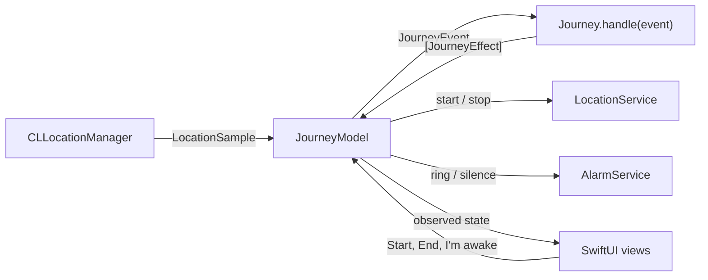

# Destination Arrival

[](https://github.com/ardakaan78715-gif/destination-arrival/actions/workflows/ci.yml)

An iOS alarm that wakes you about two minutes before your stop, so you can doze on the train without sailing past it.

## Why it exists

You nod off on the train and wake up two stops too late. Map apps will show you where you are, but they will not wake you up. Destination Arrival does one thing: it watches the journey and rings shortly before you arrive.

## What it does

- Opens on a map of London. Search for a station or address, or tap the map to drop a pin. Places outside London are refused for now.
- Lets you choose how early to be woken: 1, 2, 3, 5 or 10 minutes before arrival (2 minutes by default). It also rings once you are within 750 m of the stop, whichever happens first.
- Asks for location and notification permission only when you tap **Start journey**.
- Shows the destination, the distance left and an estimated time to arrival while you travel.
- Ignores GPS glitches and platform jitter, and keeps its speed estimate through station stops.
- Rings with a full-screen alert and a notification, then stops with one large **I'm awake** button.

Tracking currently runs while the app is open. Background tracking with a locked phone is next on the [roadmap](#roadmap).

## How it decides when to wake you

Every rule below lives in the ArrivalKit package, behind `Journey.handle(_:)`, and is covered by unit tests.

1. **Filter the fixes.** A location fix is dropped if its accuracy is negative or worse than 200 m, if it was cached more than 60 seconds before the journey started, if it is not newer than the last accepted fix, or if getting there from the last accepted fix implies a speed above 90 m/s. The jump check divides by the time since that fix, so the first fix after a four-minute tunnel is accepted even though it is kilometres from the last one.
2. **Measure the cruise speed.** Fixes accurate to 100 m or better become speed points at least 10 seconds apart. A step between two points counts as moving only when it covers more ground than the fixes' accuracy and averages at least 2.5 m/s. The cruise speed is the moving distance divided by the moving time over the last 3 minutes, once at least 30 seconds of movement has been seen. It is worked out again only when a new moving step arrives, so station dwells and platform jitter never drag it towards zero, and braking into a station cannot pull it down while the train waits. The last measured speed is kept through stops.
3. **Take the pessimistic distance.** The straight-line distance to the stop is reduced by the fix's accuracy, giving the closest the phone could be. A coarse 150 m station Wi-Fi fix still counts, but it can only bring the alarm forward.
4. **Estimate the time to arrival** as that distance divided by the cruise speed.
5. **Ring** when the time to arrival drops to your chosen lead time, or when you are inside the radius, whichever comes first. Put another way, the alarm distance is `max(cruise speed × lead time, radius)`. A lead-time ring needs a measured speed, so jitter while standing still is never mistaken for a train about to arrive.
6. **Ring exactly once.** Late fixes after the alarm are ignored.

### Why it errs early

- A straight line is never longer than the track, so the distance left is never overestimated.
- The cruise speed leaves out the station dwells still to come, which shortens the estimated time left rather than stretching it.
- Every distance is reduced by the fix's accuracy.

Each of these can only move the alarm earlier. Waking a minute early is a small cost; missing the stop is the failure the app exists to prevent.

### Tuning

The constants live in `ArrivalTuning.standard`, which is passed into `Journey` so tests can vary it.

| Constant | Value | Reason |
|---|---|---|
| `maximumAccuracy` | 200 m | Station Wi-Fi fixes (30-150 m) count for distance; cell-tower fixes (kilometres) do not |
| `maximumSpeedAccuracy` | 100 m | Speed needs fixes sharp enough to measure 10 s of travel |
| `maximumPlausibleSpeed` | 90 m/s | Faster implied jumps are glitches. It uses the elapsed time, so a long tunnel gap still passes |
| `staleFixAllowance` | 60 s | Cached fixes from before the journey started are ignored |
| `speedStep` | 10 s | Minimum spacing between speed points |
| `maximumSpeedStep` | 30 s | A longer gap may hide a stop, so it never counts towards speed |
| `movingSpeed` | 2.5 m/s | Slower steps are a dwell or jitter |
| `speedWindow` | 180 s | Long enough to span a station dwell |
| `minimumMovingTime` | 30 s | Moving time needed before a speed counts as measured |

## Architecture



| Folder | Role |
|---|---|
| `Packages/ArrivalKit` | Pure Swift package with every decision: models, fix filtering, cruise speed, the arrival estimate and the `Journey` state machine. It uses only Foundation and CoreLocation types and is fully unit-tested. |
| `App/Services` | Protocols for location, alarms and place search, plus implementations on UserNotifications and MapKit. |
| `App/Platform` | The only folder that touches iOS-only APIs: the `CLLocationManager` wrapper and the live composition of services. |
| `App/Planning`, `App/Journey` | `@Observable` models and SwiftUI screens for choosing a destination, tracking the journey and ringing. |

**Why a reducer.** `Journey` is a value type that turns each event (journey started, location received, alarm stopped, cancelled) into a list of effects (start or stop location updates, ring, silence). It has no clocks, timers or I/O, and time arrives inside the events. That makes it deterministic: every scenario is just a list of fixes, and the tests replay them on macOS. The app performs the effects through injected services and contains no arrival logic of its own.

## Run it

Requirements: Xcode 16 or later and iOS 17 or later. No developer account is needed to run it in the Simulator.

1. Open `DestinationArrival.xcodeproj` and run the **DestinationArrival** scheme on an iPhone simulator.
2. The scheme simulates a location in central London. To see the alarm, pick a destination within 750 m of it, or move the simulated location with **Features > Location > Custom Location**.

The Xcode project is generated by XcodeGen from `project.yml`. After changing `project.yml`, run `xcodegen generate` and commit both.

## Tests

```sh
swift test --package-path Packages/ArrivalKit
```

The tests use Swift Testing. ArrivalKit imports only Foundation and CoreLocation, so the whole suite runs on macOS with just the Swift toolchain: no Xcode, no simulator and no device. They cover the destination and settings models, the London service area and distance measurement; the fix filter's rules and their order; the cruise speed through steady runs, station dwells, platform jitter, coarse fixes and long gaps; the pessimistic arrival estimate; and the journey state machine: starting, ignoring rejected fixes, ringing inside the radius, ringing within the lead time, never ringing on jitter, ringing exactly once, stopping, cancelling and ignoring events before the start. Jittered fixes come from a seeded generator, so every run is identical.

### Continuous integration

Every push to `main` and every pull request runs two jobs on GitHub's macOS 15 runners:

| Job | What it does |
|---|---|
| **ArrivalKit tests** | Runs `swift test --package-path Packages/ArrivalKit`, so every arrival rule is checked on each change. |
| **iOS Simulator build** | Builds the app for the generic iOS Simulator with `xcodebuild` and `CODE_SIGNING_ALLOWED=NO`, so no certificate or developer account is involved. It uses the committed Xcode project, so CI does not need XcodeGen. |

## Privacy

Everything stays on the device. There are no accounts, analytics or third-party SDKs. Location is used only during a journey, with When In Use permission. MapKit search is the only network use.

## Roadmap

- Counting down through Underground tunnels with no signal
- Background tracking with the phone locked, with battery-aware accuracy
- A loud alarm through the silent switch, a lock-screen Stop button and a backup alarm held by iOS
- A timed Simulator demo route along the Metropolitan line
- Settings for the wake radius and distance units, and a way to test the alarm
- Recent and favourite destinations
- Readiness checks before a journey, and accessibility across every screen
- Siri and Shortcuts, AlarmKit on iOS 26, and a Live Activity
- More cities beyond London

## Licence

MIT. Copyright (c) 2026 ardakaan78715-gif. See [LICENSE](LICENSE).
