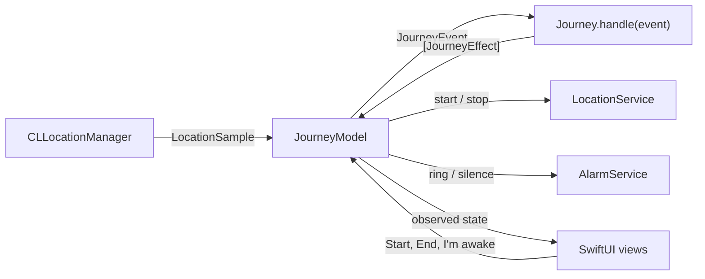

# Destination Arrival

An iOS alarm that wakes you about two minutes before your stop, so you can doze on the train without sailing past it.

## Why it exists

You nod off on the train and wake up two stops too late. Map apps will show you where you are, but they will not wake you up. Destination Arrival does one thing: it watches the journey and rings shortly before you arrive.

## What it does

- Opens on a map of London. Search for a station or address, or tap the map to drop a pin. Places outside London are refused for now.
- Lets you choose how early to be woken: 1, 2, 3, 5 or 10 minutes before arrival (2 minutes by default). It also rings once you are within 750 m of the stop, whichever happens first.
- Asks for location and notification permission only when you tap **Start journey**.
- Shows the destination, the distance left and an estimated time to arrival while you travel.
- Rings with a full-screen alert and a notification, then stops with one large **I'm awake** button.

Tracking currently runs while the app is open. Background tracking with a locked phone is next on the [roadmap](#roadmap).

## How it decides when to wake you

- **Speed** comes from the last minute of location fixes. Only fixes accurate to 100 m or better count. The app needs 20 seconds of data and at least 1 m/s before it trusts a speed.
- **Time to arrival** is the straight-line distance to the stop divided by that speed.
- **The alarm rings** when the time to arrival drops to your chosen lead time, or when you are inside the radius, whichever comes first. Put another way, the alarm distance is `max(speed × lead time, radius)`.
- **It rings exactly once.** Late fixes after the alarm are ignored.

All of this lives in `Journey.handle(_:)` in the ArrivalKit package, so every rule is covered by a unit test.

## Architecture



| Folder | Role |
|---|---|
| `Packages/ArrivalKit` | Pure Swift package with every decision: models, speed estimation, the arrival estimate and the `Journey` state machine. It uses only Foundation and CoreLocation types and is fully unit-tested. |
| `App/Services` | Protocols for location, alarms and place search, plus implementations on UserNotifications and MapKit. |
| `App/Platform` | The only folder that touches iOS-only APIs: the `CLLocationManager` wrapper and the live composition of services. |
| `App/Planning`, `App/Journey` | `@Observable` models and SwiftUI screens for choosing a destination, tracking the journey and ringing. |

**Why a reducer.** `Journey` is a value type that turns each event (journey started, location received, alarm stopped, cancelled) into a list of effects (start or stop location updates, ring, silence). It has no clocks, timers or I/O, and time arrives inside the events. That makes it deterministic: every scenario is just a list of fixes, and the tests replay them on macOS. The app performs the effects through injected services and contains no arrival logic of its own.

## Run it

Requirements: Xcode 16 or later and iOS 17 or later. No developer account is needed to run it in the Simulator.

1. Open `DestinationArrival.xcodeproj` and run the **DestinationArrival** scheme on an iPhone simulator.
2. The scheme simulates a location in central London. To see the alarm, pick a destination within 750 m of it, or move the simulated location with **Features > Location > Custom Location**.

The Xcode project is generated by XcodeGen from `project.yml`. After changing `project.yml`, run `xcodegen generate` and commit both.

## Tests

```sh
swift test --package-path Packages/ArrivalKit
```

The tests use Swift Testing and run on macOS without Xcode. They cover the destination and settings models, the London service area, distance measurement, the speed estimator, the arrival estimate and the journey state machine: starting, ringing inside the radius, ringing within the lead time, ringing exactly once, stopping, cancelling and ignoring events before the start.

## Privacy

Everything stays on the device. There are no accounts, analytics or third-party SDKs. Location is used only during a journey, with When In Use permission. MapKit search is the only network use.

## Roadmap

- Continuous integration for the package tests and an iOS Simulator build
- Speed that survives station stops and GPS noise
- Counting down through Underground tunnels with no signal
- Background tracking with the phone locked, with battery-aware accuracy
- A loud alarm through the silent switch, a lock-screen Stop button and a backup alarm held by iOS
- A timed Simulator demo route along the Metropolitan line
- Settings for the wake radius and distance units, and a way to test the alarm
- Recent and favourite destinations
- Readiness checks before a journey, and accessibility across every screen
- Siri and Shortcuts, AlarmKit on iOS 26, and a Live Activity
- More cities beyond London

## Licence

MIT. Copyright (c) 2026 ardakaan78715-gif. See [LICENSE](LICENSE).
